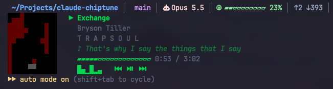
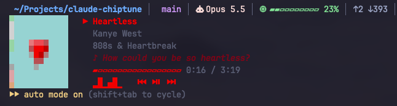

# claude-chiptune

Your Spotify track as **8-bit pixel art** in the [Claude Code](https://claude.com/claude-code) status line: the album cover, title, artist, synced lyrics, a progress bar and click-to-control buttons.





*Real screenshots in Ghostty: the accent colour follows each album cover.*

## Features

- **Pixel-art cover.** The album art is reduced to 12×12 pixels in the xterm 256-colour palette, two pixels per character cell.
- **Colours from the cover.** The title, progress bar and equalizer use the album's most vivid colour.
- **Synced lyrics** from [LRCLIB](https://lrclib.net). They are fetched in the background, so the status line never waits for them.
- **Click to control.** Cmd+click ⏮ ⏯ ⏭ to change tracks, or the title to open the song in Spotify. This works in Ghostty and iTerm2.
- **Out of the way while Claude works.** While Claude is busy, the block shrinks to a single line.
- **Nothing to install.** It uses only the Python standard library, plus the `osascript` and `sips` tools that come with macOS.
- **It never opens Spotify.** When Spotify isn't running, the block simply isn't shown.

## Requirements

- macOS with the Spotify desktop app.
- Python 3.9 or later. The `python3` that comes with macOS works.
- A terminal with 256-colour support. For the buttons and links, it also needs OSC 8 hyperlinks, which Ghostty, iTerm2, WezTerm and Kitty all support.

## Install

```sh
git clone https://github.com/Marcozaa/claude-chiptune.git ~/claude-chiptune
cd ~/claude-chiptune && ./install.sh
```

`install.sh` builds the click-to-control helper and prints the settings to add.

There are two ways to show the block.

**If you don't have a status line yet**, add this to `~/.claude/settings.json`:

```json
"statusLine": {
  "type": "command",
  "command": "python3 -I ~/claude-chiptune/chiptune.py statusline",
  "refreshInterval": 2
}
```

**If you already have a status line script**, add these lines at the end of it. The script must read Claude's JSON into `$input`.

```sh
session_id=$(printf '%s' "$input" | jq -r '.session_id // ""')
block=$(python3 -I ~/claude-chiptune/chiptune.py block "$session_id" 2>/dev/null)
[ -n "$block" ] && printf '\n%s' "$block"
```

Set `"refreshInterval": 2` on your `statusLine`, so the progress bar and lyrics keep moving.

### Shrinking while Claude works (optional)

Add these hooks to `~/.claude/settings.json`:

```json
"hooks": {
  "UserPromptSubmit": [{ "hooks": [{ "type": "command", "command": "python3 -I ~/claude-chiptune/chiptune.py hook busy" }] }],
  "Stop":             [{ "hooks": [{ "type": "command", "command": "python3 -I ~/claude-chiptune/chiptune.py hook idle" }] }],
  "SessionEnd":       [{ "hooks": [{ "type": "command", "command": "python3 -I ~/claude-chiptune/chiptune.py hook idle" }] }]
}
```

### First run

macOS asks once whether your terminal may control Spotify. Click **Allow**.

The first click on a button asks the same question for *Claude Chiptune Controls*.

## Settings

Set these environment variables in the `env` section of `settings.json` to turn features off:

| Variable | Default | Effect |
|---|---|---|
| `CHIPTUNE_LYRICS=0` | on | No lyrics, and no requests to lrclib.net |
| `CHIPTUNE_CONTROLS=0` | on | Hide the ⏮ ⏯ ⏭ buttons |
| `CHIPTUNE_COMPACT_WHILE_BUSY=0` | on | Always show the full block |

## Privacy & security

**Data sent to other services**
- Album covers are downloaded from Spotify's CDN, `i.scdn.co`. That is the only address the cover download allows.
- When lyrics are on, the title, artist, album and track length are sent to [lrclib.net](https://lrclib.net). Turn lyrics off to stop this.

**Local cache**
- Covers, lyrics and a small log are kept in `~/.cache/claude-chiptune`. Only your user can read that folder.

**Untrusted text**
- Song titles and lyrics are user-submitted, so they could contain terminal escape sequences.
- claude-chiptune removes all control, format and bidi characters before printing anything.

**The click-to-control helper**
- It is a tiny AppleScript app that `install.sh` builds with macOS's own `osacompile`. It is installed at `~/Applications/Claude Chiptune Controls.app`.
- It handles `claude-chiptune://` links and accepts only `previous`, `playpause` and `next`.
- It does nothing if Spotify isn't running.
- Any app or web page can open such a link, so the worst it can do is skip your song.

## Uninstall

1. Remove the `statusLine` and hooks entries from your settings.
2. Run `rm -rf ~/claude-chiptune ~/.cache/claude-chiptune "~/Applications/Claude Chiptune Controls.app"`.

## Development

```sh
cd tests && python3 -m unittest            # run the tests
python3 tools/demo.py | python3 tools/ansi_to_svg.py > docs/preview.svg   # demo render, no Spotify needed
```

Logs go to `~/.cache/claude-chiptune/chiptune.log`.

## License

MIT
